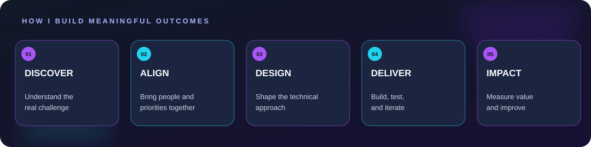

<!-- Creative Technologist | GitHub Profile README -->

  

  

  
  

## ✨ A little about me

I'm a **technologist at heart and a project leader by profession**.

With **7+ years of experience** across software engineering, IT, and technical project management, I've gone from building applications to leading cross-functional teams and delivering complex technology solutions.

My interests span **software architecture, healthcare technology, DevSecOps, data, and AI**. I enjoy exploring how people, technology, and thoughtful execution come together to solve meaningful problems.

> Great technology isn't just about writing better code—it's about building things that make a difference.

- 🔭 **What I do:** Lead technical delivery, align stakeholders, and help engineering teams turn ideas into working products.
- 🧠 **What drives me:** Solving complex problems, learning new technologies, and improving how teams build software.
- 🌱 **What I'm exploring:** AI-assisted development, automation, and modern engineering workflows.
- 🤝 **Let's talk about:** Agile delivery, system design, developer experience, and technical leadership.
- 📍 **Based in:** Karachi, Pakistan · Collaborating across time zones.

## 🛠️ My toolkit

**Languages & frameworks**

  

**DevOps, databases & developer tools**

  

**Beyond the code**

## 🚀 Featured GitHub projects

A selection of public repositories reflecting my interests in **data science, intelligent systems, automation, and software engineering**.

| Project | What it explores | Repository |
| --- | --- | --- |
| **Heart Disease Prediction System** | A mobile-oriented predictive analytics concept using data mining models to assess heart-disease risk. | [Explore project](https://github.com/itratjassani/Heart-Disease-Prediction-System) |
| **Invoice Data Extraction** | Extracting information from handwritten invoices to reduce manual data-entry work. | [Explore project](https://github.com/itratjassani/Data-Extraction-from-Invoice-Images) |
| **Social Media Sentiment Analysis** | Analyzing text sentiment across positive, neutral, and negative categories. | [Explore project](https://github.com/itratjassani/Sentiment-Analysis-of-Twitter-Data) |
| **Agentic AI Engineering** | Educational exploration of AI agents and associated engineering patterns. | [Explore repository](https://github.com/itratjassani/agents) |
| **Data Science Explorations** | Coursework and experiments covering data science concepts and tools. | [Explore repository](https://github.com/itratjassani/data-science-course) |

> Some repositories are educational or experimental projects rather than production-ready applications.

## 💼 Professional projects & product delivery

Over the years, I've helped coordinate engineering and delivery across complex products. The examples below are intentionally **anonymized**; source code and client-specific details are not included.

| Industry / initiative | Product challenge | My focus |
| --- | --- | --- |
| **Healthcare Compliance & Clinical Operations Platform** | Digitizing clinical monitoring, staff verification, and reporting workflows. | Technical project leadership · Agile delivery · Cross-functional coordination |
| **Biomedical Asset & Maintenance Management System** | Managing equipment inventories, work orders, scheduled maintenance, and operational reporting. | Product planning · Workflow design · Engineering delivery |
| **Software Supply Chain Security Platform** | Improving visibility into dependencies, security advisories, and software upgrade processes. | Developer workflows · Stakeholder alignment · Delivery planning |
| **Enterprise Warehouse Automation Solution** | Streamlining warehouse workflows and integrating operational equipment with software systems. | Systems integration coordination · Process improvement · Delivery management |

*These summaries describe professional experience at a high level, not public code repositories or products personally owned by me. Specific clients, product names, and internal implementation details are omitted.*

## 📈 GitHub contributions

  

Generated from my GitHub contribution calendar with an automated workflow. Contributions to private repositories may not be fully reflected.

## 💡 From challenge to impact

  

I connect **technical depth** with **product thinking and people-first leadership**—from understanding a challenge to delivering something useful.

## 🌐 Let's connect

Whether it's exchanging ideas about software engineering, discussing technical delivery, or collaborating on something interesting, I'm always happy to connect.

**[LinkedIn](https://www.linkedin.com/in/itrat-zehra-jassani/)** · **[GitHub](https://github.com/itratjassani)**

  

